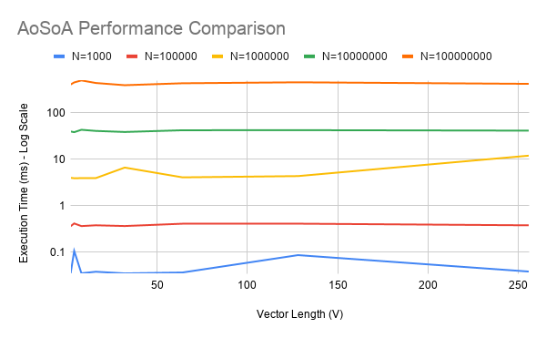

# LAB 04 - AoSoA

## About

In this lab I worked with AoSoA (Array of Structures of Arrays).

I completed the missing code in `aosoa_measurement.cpp`.

I added memory allocation, random RGB values and memory deallocation.

## Testing

I used these array sizes:

- 1000
- 10000
- 100000
- 1000000
- 10000000

For every size I tested V = 2, 4, 8, 16, 32, 64, 128 and 256.

I used `make` commands to run the tests. I tested the program with `-O3` optimization.

The results are saved in CSV files.

## Results

When N was bigger, the program needed more time.

For N = 1000 and N = 10000, V = 2 was the fastest.

For N = 100000 and N = 1000000, V = 4 was the fastest.

For N = 10000000, V = 32 was the fastest with 394.520 ms.

I can see that different V values give different results. Sometimes the difference is small and sometimes it is bigger.

I only ran each test one time, so the results can be different if I run them again.

## Google Sheets

I put my results in Google Sheets and made a chart.

Google Sheets link:

https://docs.google.com/spreadsheets/d/12ylHXDf74yS0bUXOBFCEsdw4LZJXMxTqi_hxR64Pi4g/edit?usp=sharing

## Chart

## Conclusion

In this lab I learned how AoSoA works and how to test execution time.

I also learned how to save results in CSV files and make a chart in Google Sheets.
