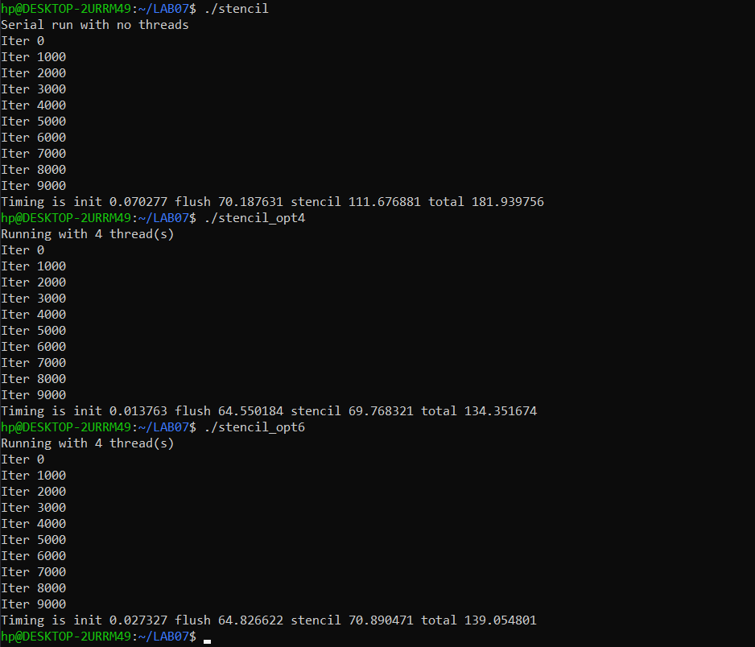

# LAB 07 - OpenMP that performs

## 1. Introduction

In this lab, I tested three versions of stencil code to see how OpenMP affects execution time.

I used Ubuntu WSL and GCC 15.2.0. I compiled the programs with `-O3 -fopenmp`.

## 2. Results

I tested the serial version and two OpenMP versions using 4 threads.

| Version | Threads | Init | Flush | Stencil | Total |
|---|---|---|---|---|---|
| stencil.c | 1 | 0.070277 | 70.187631 | 111.676881 | 181.939756 |
| stencil_opt4.c | 4 | 0.013763 | 64.550184 | 69.768321 | 134.351674 |
| stencil_opt6.c | 4 | 0.027327 | 64.826622 | 70.890471 | 139.054801 |

## 3. Comparison

The first version is serial and uses only one thread. It had the longest execution time.

The second version uses OpenMP to run parts of the code in parallel. It was the fastest in my test.

The third version also uses 4 threads and has additional optimizations to reduce synchronization. However, in my test it was a little slower than opt4.

In stencil_opt4.c, OpenMP uses implicit barriers, but `nowait` removes one of them.

In stencil_opt6.c, explicit barriers are used with `#pragma omp barrier` to synchronize threads.

The serial version does not use OpenMP barriers.

## 4. Questions

**1. How many threads did your CPU use?**

The serial version used one thread. Both OpenMP versions used 4 threads.

**2. What parts of the code were improved? What strategies were used?**

The main improvements were in the loops and synchronization. OpenMP was used to divide the work between threads. The optimized code also reduces unnecessary waiting between threads.

**3. What is the difference between explicit and implicit barriers?**

An implicit barrier is automatically added by OpenMP, for example at the end of a parallel for loop.

An explicit barrier is manually added using `#pragma omp barrier`.

Both are used to synchronize threads. The optimized versions reduce unnecessary barriers to improve performance.

## 5. Conclusion

OpenMP improved the execution time compared to the serial version. In my test, stencil_opt4 was the fastest. The results can change a little between runs.

## 6. Terminal Screenshot

