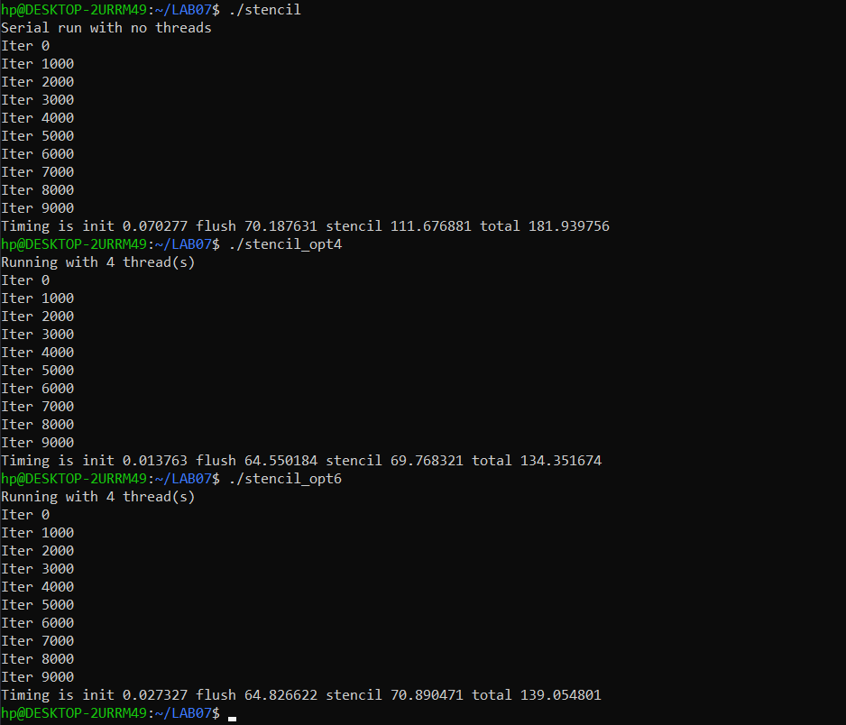

# Assignment 6 - OpenMP

## About this lab

In this lab, I tested three versions of a stencil program. I wanted to see if the program would run faster when using OpenMP.

I used Ubuntu WSL and GCC 15.2.0.

## My results

I tested the first version with one thread and the other two versions with 4 threads.

| Program | Threads | Total time (s) |
|---|---|---|
| stencil.c | 1 | 181.939756 |
| stencil_opt4.c | 4 | 134.351674 |
| stencil_opt6.c | 4 | 139.054801 |

The first program was the slowest because it runs without OpenMP.

The second program was the fastest in my test.

The third program was also faster than the first one, but a little slower than the second one.

## Questions

### 1. How many threads did I use?

I used 1 thread for the normal version and 4 threads for the OpenMP versions.

### 2. What was improved?

The main change was that OpenMP allowed different threads to work on parts of the program at the same time.

The optimized versions also try to reduce the time threads spend waiting for each other.

### 3. What is the difference between implicit and explicit barriers?

A barrier is a place where threads wait for each other before continuing.

An implicit barrier is added automatically by OpenMP.

An explicit barrier is written directly in the code using `#pragma omp barrier`.

In stencil_opt4.c, there are implicit barriers, and `nowait` is used to skip one of them.

In stencil_opt6.c, explicit barriers are used to make threads wait at certain points.

The normal stencil.c version does not use OpenMP barriers.

## Conclusion

From my results, OpenMP made the program faster. The best result was with stencil_opt4.c.

## Terminal screenshot

More detailed timings are saved in results.txt.
